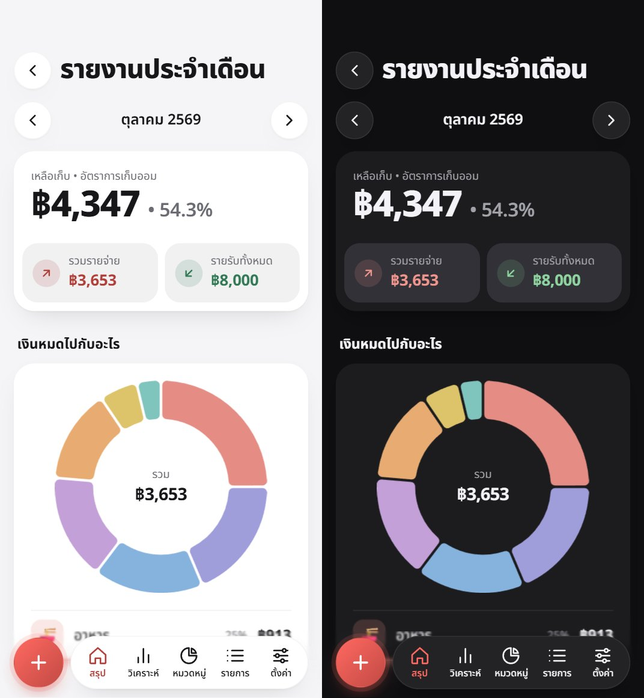
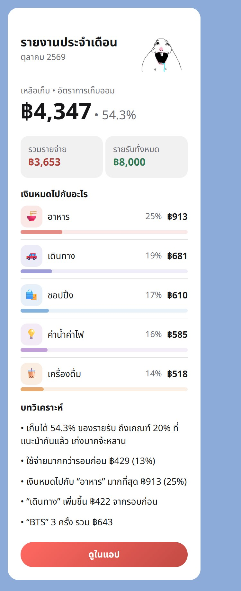
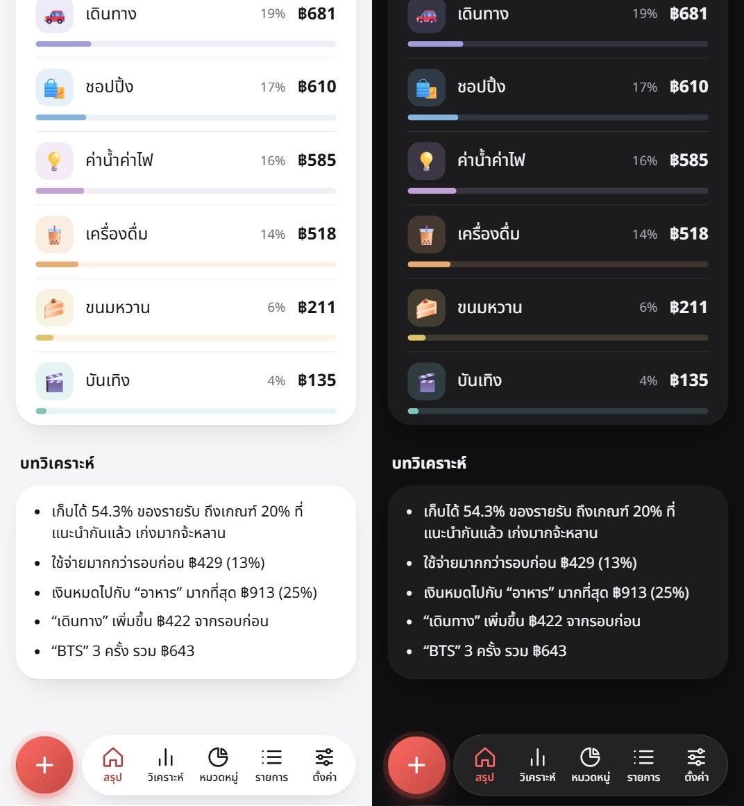
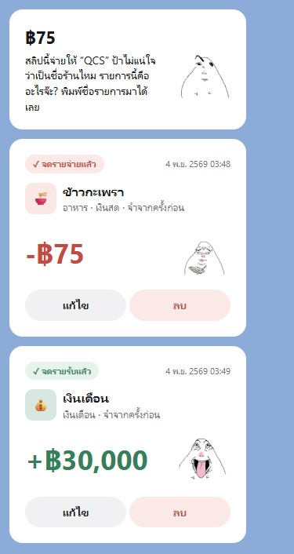

# ป้าคีน

A LINE chatbot that records income and expenses, with a web app for summaries and charts. Type "กาแฟ 60", or send a slip, a voice note or a PDF, and ป้าคีน records it. Everything runs on free tiers: Cloudflare Workers with a D1 database, and Gemini's free API.

  
  

  

## รายงานประจำเดือน

Every period gets a report: รวมรายจ่าย, รายรับทั้งหมด, เหลือเก็บ • อัตราการเก็บออม, เงินหมดไปกับอะไร and บทวิเคราะห์. The analysis compares the savings rate with a 20% goal and spending with the period before, and points out the biggest category, the one that grew most, and things bought again and again.

  
  

## In the LINE chat

Cards in the chat carry a hamster with a mood to match: typing an entry in, overjoyed at income, suspicious of a slip, or crying over an overspent month. The web app stays plain, without the hamster.

  
  

The hamsters are from [silly hamsters](https://store.line.me/stickershop/product/31413469/en) by shiba. Characters © shiba, used with permission.

- **Type an entry:** "กาแฟ 60", "ข้าว 50 น้ำ 20" (several items in one message) or "เงินเดือน 30000". The bot sorts each item into one of your categories.
- **Send a slip, voice note or PDF.** For a slip, ป้าคีน records the amount as cash and shows the saved card. A slip paid to a clearly named shop or restaurant keeps that name. One paid to a person, or to a name that doesn't say what the place is (a code like QCS, an abbreviation like ก.กาแฟสด), first asks what it was, then files it into a category based on your answer. Your last answer for that name is offered as a button, and "ใช้ชื่อนี้" keeps the name and stops the question for it.
- **Saved card:** each entry comes back as a card with a hamster, แก้ไข (opens it in the web app) and ลบ. In settings you can switch to a short text reply instead.
- **Category memory:** a name you've used before goes to the same category as last time.
- **Payment channels (optional):** cash and credit cards. The bot asks which one only when it can't tell.
- **รายงานประจำเดือน:** รวมรายจ่าย, รายรับทั้งหมด, เหลือเก็บ • อัตราการเก็บออม, เงินหมดไปกับอะไร and บทวิเคราะห์. It arrives by itself when a new period starts (at your reminder time, or 09:00; can be turned off in settings).
- **Commands:** "สรุป" for this period's totals, "รายงาน" for the last finished period's report ("รายงานเดือนนี้" for this one, "รายงานเดือนก่อน" for the last), "ลบ" to delete the last entry, "แอป" for a link to the web app.
- **Chat menu:** tiles under the chat open each tab of the web app.
- **Daily reminder:** a message at your chosen time on days with nothing recorded.
- **Recurring entries:** daily, weekly or monthly, added automatically.

## Web app

Opened from the chat menu with a personal signed link. No password needed.

| Tab | What it shows |
|---|---|
| สรุป | Income, expenses and what's left for the current period (starts on your chosen day of the month), a link to รายงานประจำเดือน, spending by category, totals per payment channel, latest entries |
| วิเคราะห์ | Six months of income and expense bars; daily bars for spending or income with the daily spending average; spending by category for any month or all time |
| หมวดหมู่ | Add, rename, recolour and reorder categories, and give each one an emoji; set the day each period starts |
| รายการ | Every entry, filtered by type, period and category (only categories used in that period, biggest spend first); select several to recategorise or delete; export to Excel or CSV |
| ตั้งค่า | Category memory, reply style, recurring entries, payment channels and cards, reminder time, the monthly report on or off, theme (light, dark or match device), Thai or English, currency, time zone |

  
  

  
  

## How it works

- `src/index.js`: one Cloudflare Worker handles the LINE webhook (with signature check), calls Gemini, stores data in D1, serves the web app's API, and runs a cron every 5 minutes for reminders and chat-menu refreshes.
- `public/index.html`: the web app, a single file with no build step. Chart.js and SheetJS load from cdnjs with an integrity hash, so the browser refuses a file that has changed; to update one, change its address and take the new hash from [cdnjs.com](https://cdnjs.com).
- **Gemini:** typed messages, slips, voice notes and PDFs all try the fastest model first. If a model is busy or out of free quota, the next one in the list is used, and if it is slow, the next one is started alongside it. Both lists are in `wrangler.toml`.
- **Privacy:** only 1:1 chats are read, never group chats. Each user's web app link is signed and expires, and the API only accepts a user's own categories and payment channels.
- `public/report.js`: the monthly report's numbers and analysis, one copy used by both the web app and the worker. The analysis is written by rules, so it costs no AI quota.
- `public/categories.js`: the category colours and the built-in categories' emoji, shared the same way, so the LINE cards and the web app always match.
- `public/chars/*.png`: the hamsters for the LINE cards, one per mood (© shiba, used with permission). After replacing one, bump `CHAR_VERSION` in `src/index.js`, because LINE caches images by address.
- **Speed:** the tables are indexed per user, so a query reads only that user's rows, which also keeps D1's free daily reads for real use. Reads that don't depend on each other go to D1 together rather than one after another, and the web app asks for its data from the top of the page, so it doesn't wait for the rest of the page first.
- `make-menu.py`: draws the chat menu image (`public/menu.jpg`, macOS only).
- `test.mjs`: an end-to-end check that runs the worker locally against a mock LINE and Gemini (`npm test`).
- `seed.mjs`: fills a local `wrangler dev` with a test user and a few months of sample entries, and prints a link to open the web app as that user (`npm run seed`).
- `check.mjs`: a syntax check of the worker, the scripts and the web app's inline scripts (`npm run check`, which then bundles the worker without deploying).

## Local development

Needs Node.js 20 or newer.

1. `npm install`
2. `cp .dev.vars.example .dev.vars`. Its `dev` values are enough to open the web app locally; put real ones in to talk to LINE and Gemini.
3. `npm run dev` starts the worker on http://localhost:8787 with a local D1 database.
4. In a second terminal, `npm run seed` adds a test user with a few months of entries and prints a link that opens the web app as that user.

`npm run check` and `npm test` also run in CI on every push to main and every pull request.

## Settings

| Name | Kind | Set in | What it's for |
|---|---|---|---|
| `LINE_CHANNEL_SECRET` | secret | `wrangler secret put`, or `.dev.vars` locally | checks LINE's webhook signature and signs the web app links |
| `LINE_CHANNEL_ACCESS_TOKEN` | secret | same | calls the LINE Messaging API |
| `GEMINI_API_KEY` | secret | same | calls Gemini |
| `APP_ORIGIN` | variable | `wrangler.toml` | the worker's own address, for the scheduled job, which has no request to read it from |
| `GEMINI_MODEL` | variable | `wrangler.toml` | models tried in order for slips, voice notes and PDFs |
| `GEMINI_FAST_MODEL` | variable | `wrangler.toml` | models tried in order for typed messages |
| `LINE_API`, `LINE_DATA_API`, `GEMINI_API` | optional | `.dev.vars` | send those calls to a mock instead of the real APIs; `test.mjs` uses them |

## Run your own

1. Create a LINE Messaging API channel and get a Gemini API key.
2. `npm install`, then `npx wrangler d1 create paakeen`, put the database id in `wrangler.toml`, and set `APP_ORIGIN` to your worker's URL. Change the link-preview image's address (`og:image`, near the top of `public/index.html`) to it as well.
3. `npx wrangler secret put LINE_CHANNEL_SECRET`, then the same for `LINE_CHANNEL_ACCESS_TOKEN` and `GEMINI_API_KEY`.
4. `npm run deploy`, then set the LINE webhook URL to `https://<your worker>/webhook`.

## License

The code is under the [MIT License](LICENSE). The hamster pictures are not: `public/chars/*.png`, `docs/characters.png` and the hamsters in `docs/line-cards.jpg` and `docs/line-report.jpg` are from [silly hamsters](https://store.line.me/stickershop/product/31413469/en) by shiba, © shiba, used here with permission, and may not be reused without shiba's own permission.
