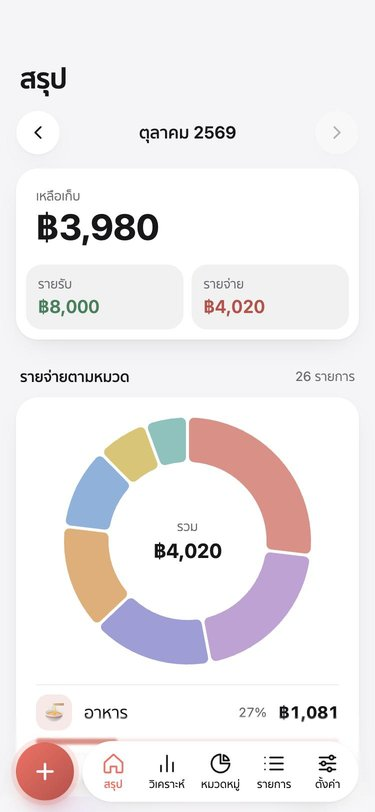
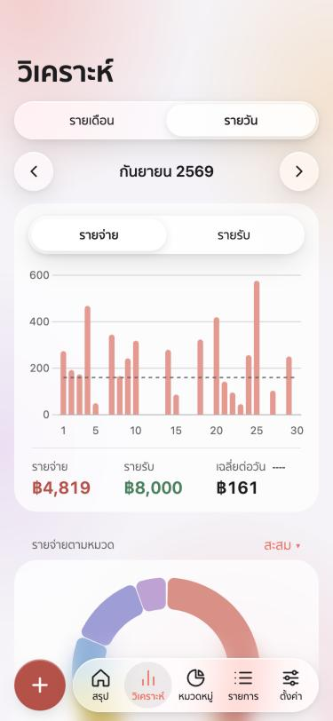
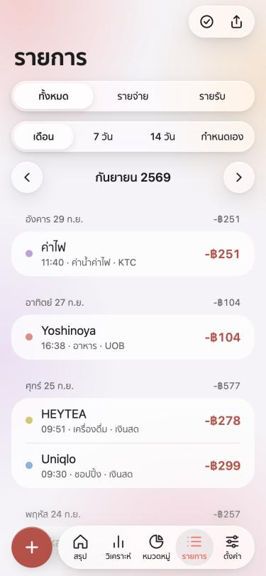
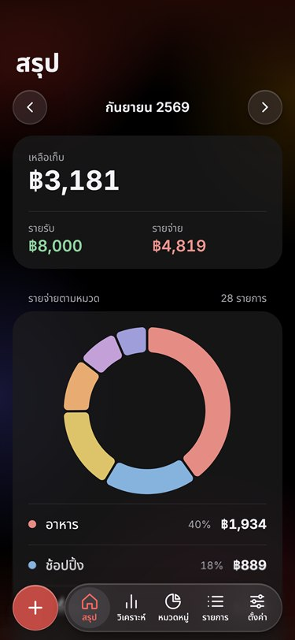
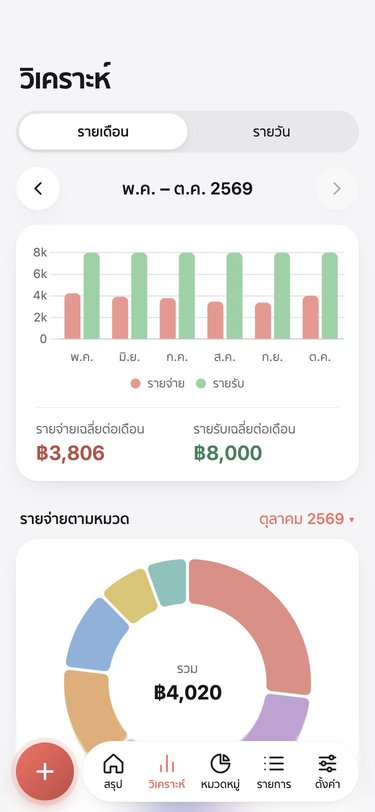
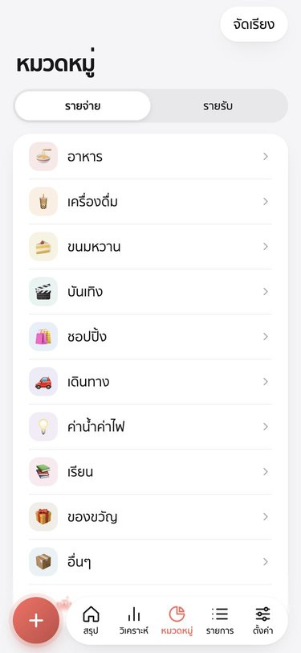
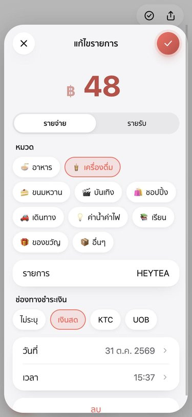

# ป้าคีน

A LINE chatbot that records income and expenses, with a web app for summaries and charts. Type "กาแฟ 60", or send a slip, a voice note or a PDF, and ป้าคีน records it. Everything runs on free tiers: Cloudflare Workers with a D1 database, and Gemini's free API.

  
  
  
  

## In the LINE chat

- **Type an entry:** "กาแฟ 60", "ข้าว 50 น้ำ 20" (several items in one message) or "เงินเดือน 30000". The bot sorts each item into one of your categories.
- **Send a slip, voice note or PDF.** For a slip, ป้าคีน records the amount as cash, asks what it was, files it into a category based on that name, and shows the saved card.
- **Saved card:** each entry comes back as a card with แก้ไข (opens it in the web app) and ลบ. In settings you can switch to a short text reply instead.
- **Category memory:** a name you've used before goes to the same category as last time.
- **Payment channels (optional):** cash and credit cards. The bot asks which one only when it can't tell.
- **Commands:** "สรุป" for this period's totals, "ลบ" to delete the last entry, "แอป" for a link to the web app.
- **Chat menu:** tiles under the chat open each tab of the web app.
- **Daily reminder:** a message at your chosen time on days with nothing recorded.
- **Recurring entries:** daily, weekly or monthly, added automatically.

## Web app

Opened from the chat menu with a personal signed link. No password needed.

| Tab | What it shows |
|---|---|
| สรุป | Income, expenses and what's left for the current period (starts on your chosen day of the month), spending by category, totals per payment channel, latest entries |
| วิเคราะห์ | Six months of income and expense bars; daily bars for spending or income with the daily spending average; spending by category for any month or all time |
| หมวดหมู่ | Add, rename, recolour and reorder categories; set the day each period starts |
| รายการ | Every entry, filtered by type, period and category (only categories used in that period, biggest spend first); select several to recategorise or delete; export to Excel or CSV |
| ตั้งค่า | Category memory, reply style, recurring entries, payment channels and cards, reminder time, theme (light, dark or match device), Thai or English, currency, time zone |

  
  
  

## How it works

- `src/index.js`: one Cloudflare Worker handles the LINE webhook (with signature check), calls Gemini, stores data in D1, serves the web app's API, and runs a cron every 5 minutes for reminders and chat-menu refreshes.
- `public/index.html`: the web app, a single file with no build step (Chart.js and SheetJS load from a CDN).
- **Gemini:** typed messages try the fastest model first, while slips, voice notes and PDFs try the strongest. If a model is busy or out of free quota, the next one in the list is used. Both lists are in `wrangler.toml`.
- **Privacy:** only 1:1 chats are read, never group chats. Each user's web app link is signed and expires.
- `make-menu.py`: draws the chat menu image (`public/menu.jpg`, macOS only).
- `test.mjs`: an end-to-end check that runs the worker locally against a mock LINE and Gemini (`node test.mjs`).
- `seed.mjs`: fills a local `wrangler dev` with a test user and a few months of sample entries, and prints a link to open the web app as that user.

## Run your own

1. Create a LINE Messaging API channel and get a Gemini API key.
2. `npx wrangler d1 create paakeen`, then put the database id in `wrangler.toml`, and set `APP_ORIGIN` to your worker's URL.
3. `npx wrangler secret put LINE_CHANNEL_SECRET`, then the same for `LINE_CHANNEL_ACCESS_TOKEN` and `GEMINI_API_KEY`.
4. `npx wrangler deploy`, then set the LINE webhook URL to `https://<your worker>/webhook`.
